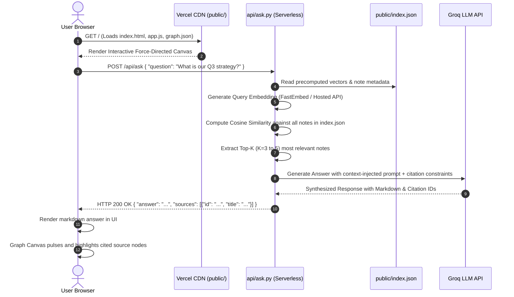

# SecondSelf — Technical Architecture Specification

## 1. Executive Summary & Vision

**SecondSelf** is an autonomous, self-organizing personal AI second brain. It bridges the gap between passive content capture and proactive knowledge synthesis. Traditional personal knowledge management (PKM) systems (Notion, Obsidian, Apple Notes, Pocket) suffer from the *Ingestion Friction vs. Retrieval Decay Paradox*: information is captured easily but deposited into hierarchical silos where it remains unread, unconnected, and unsearchable by semantic intent.

SecondSelf solves this through an end-to-end, dual-plane architecture:
1. **Offline Ingestion & Synthesis Engine:** Runs locally, capturing unstructured notes, URLs, and files; utilizing Large Language Models (Groq Llama 3) for automated classification under the **PARA** (Projects, Areas, Resources, Archives) framework, and calculating dense vector embeddings to autonomously construct bidirectional semantic links.
2. **Cloud-Native Interactive Graph & Serverless RAG Plane:** Deployed to **Vercel**, serving a static, force-directed interactive knowledge graph coupled with a sub-second serverless Retrieval-Augmented Generation (RAG) query engine.

```
                    ┌────────────────────────────────────────────────────────┐
                    │               OFFLINE LOCAL BUILD PLANE                │
                    │                                                        │
┌──────────────┐    │  ┌──────────────┐   Groq LLM   ┌────────────────────┐  │
│ User Input:  │───>│  │  capture.py  │─────────────>│    classify.py     │  │
│ Note/URL/PDF │    │  │ (raw/*.json) │              │ (wiki/**/*.md)     │  │
└──────────────┘    │  └──────────────┘              └─────────┬──────────┘  │
                    │                                          │             │
                    │                                Sentence-Transformers   │
                    │                                          ▼             │
                    │  ┌──────────────┐  JSON Export ┌────────────────────┐  │
                    │  │build_graph.py│<─────────────│      link.py       │  │
                    │  └──────┬───────┘              │ (public/index.json)│  │
                    │         │                      └────────────────────┘  │
                    └─────────┼──────────────────────────────────────────────┘
                              │ Git Push / CI-CD
                              ▼
                    ┌────────────────────────────────────────────────────────┐
                    │               VERCEL CLOUD RUNTIME PLANE               │
                    │                                                        │
                    │  ┌──────────────────────────────────────────────────┐  │
                    │  │          Vercel Static Edge CDN (public/)        │  │
                    │  │    • index.html (Responsive Canvas & UI)         │  │
                    │  │    • app.js (vis-network Physics Engine)         │  │
                    │  │    • graph.json (Node/Edge Visual Model)         │  │
                    │  └─────────────────────────┬────────────────────────┘  │
                    │                            │ User Query                │
                    │                            ▼                           │
                    │  ┌──────────────────────────────────────────────────┐  │
                    │  │      Vercel Serverless Function (api/ask.py)     │  │
                    │  │    • Precomputed Vector Similarity Ranking       │  │
                    │  │    • Context Assembly & Dynamic Prompting        │  │
                    │  │    • Groq LLM Ultra-Low Latency Inference        │  │
                    │  └──────────────────────────────────────────────────┘  │
                    └────────────────────────────────────────────────────────┘
```

---

## 2. Architectural Design Principles & Trade-Offs

### 2.1 The Decoupled Plane Architecture: Build vs. Runtime

A primary technical tension in AI web applications is between **heavy computational dependencies** (PyTorch, transformer weights, web scrapers) and **serverless runtime constraints** (bundle limits, cold starts, memory budgets).

SecondSelf resolves this by strictly decoupling the lifecycle into two operational planes:

| Dimension | Offline Build Plane (Local Machine) | Online Serving Plane (Vercel) |
|---|---|---|
| **Primary Responsibility** | Capture, parsing, LLM categorization, vectorization, auto-linking, graph generation. | Static graph visualization, semantic vector search, real-time question answering. |
| **Compute Profile** | Heavy compute, batch processing, PyTorch (`sentence-transformers`), large disk caching. | Ephemeral compute, sub-second execution, lightweight runtime (pure NumPy/pure Python). |
| **Storage Model** | Local file system (`raw/`, `wiki/`), full Git repository. | Read-only static assets (`public/`), ephemeral container memory (`/tmp`). |
| **Execution Trigger** | User runs CLI scripts on demand. | HTTP requests from web clients (`GET /`, `POST /api/ask`). |
| **External Dependencies** | Groq API, HuggingFace model cache, scraping libraries. | Groq API (Inference only), Vercel CDN. |

### 2.2 Rationale: Why Not Streamlit / Persistent Containers?

Early architectural prototypes often employ Streamlit or Gradio for rapid Python prototyping. However, Streamlit was rejected for SecondSelf due to fundamental architectural mismatches:
1. **Websocket & Process Coupling:** Streamlit requires a continuously running Python process maintaining stateful WebSocket connections. This prevents deployment to serverless platforms like Vercel and necessitates dedicated VMs (EC2, Render, Railway), dramatically increasing hosting costs and idle resource waste.
2. **Execution Model:** Streamlit reruns the entire script upon user interaction, introducing lag into graph manipulation and node traversal.
3. **Frontend Flexibility:** Streamlit canvas rendering lacks native, high-performance WebGL/Canvas physics engines necessary for silky smooth, force-directed graph exploration.
4. **The Jamstack/Serverless Advantage:** By splitting into **Static Graph Assets (HTML/Canvas/vis-network)** + **Stateless Serverless API (`api/ask.py`)**, SecondSelf achieves global edge delivery, instant loading, zero idle hosting costs, and infinite horizontal scalability on Vercel's free tier.

### 2.3 Engineering Around Vercel Serverless Constraints

Deploying Python AI workflows to Vercel requires strict adherence to infrastructure limits:

```
┌──────────────────────────────────────────────────────────────────────────────┐
│                         VERCEL CONSTRAINTS & SOLUTIONS                       │
├──────────────────────────────┬───────────────────────────────────────────────┤
│ Constraint                   │ Engineering Solution                          │
├──────────────────────────────┼───────────────────────────────────────────────┤
│ 250 MB Bundle Size Limit     │ PyTorch & sentence-transformers are strictly  │
│ (Unzipped Python Lambda)     │ kept in `requirements-dev.txt`. Notes are     │
│                              │ pre-embedded locally into `public/index.json`.│
│                              │ Serverless function uses pure NumPy / ONNX    │
│                              │ or hosted embedding APIs.                     │
├──────────────────────────────┼───────────────────────────────────────────────┤
│ Read-Only Filesystem         │ Serverless function operates completely read- │
│                              │ only. No writes to disk. Ingestion and wiki   │
│                              │ mutations happen locally; updates are pushed  │
│                              │ via Git, triggering Vercel build hooks.       │
├──────────────────────────────┼───────────────────────────────────────────────┤
│ 10-15s Function Timeout      │ RAG pipeline is optimized for < 1.5s total:   │
│                              │ in-memory dot-product cosine similarity over  │
│                              │ precomputed vectors (< 15ms) + Groq LPUs      │
│                              │ inference (> 500 tokens/sec via Llama 3).     │
├──────────────────────────────┼───────────────────────────────────────────────┤
│ Secrets Management           │ No hardcoded credentials. Local runs use      │
│                              │ `.env`. Vercel deployments use encrypted      │
│                              │ Vercel Project Environment Variables.         │
└──────────────────────────────┴───────────────────────────────────────────────┘
```

---

## 3. End-to-End System Architecture

### 3.1 Component Architecture Diagram

The system comprises six discrete modules functioning across the ingestion, transformation, storage, projection, and query domains:

```mermaid
graph TD
    subgraph "1. Ingestion Layer (Local CLI)"
        A1[User CLI Command] -->|Text / URL / File| A2[capture.py]
        A2 -->|Extract Content & Metadata| A3[(raw/*.json)]
    end

    subgraph "2. Autonomous Curation Layer (Local Batch)"
        A3 --> B1[classify.py]
        B1 -->|Extract Concepts & PARA| B2[Groq Cloud: Llama 3]
        B2 -->|JSON Schema Response| B1
        B1 -->|Write Formatted Note| B3[(wiki/Projects/*\nwiki/Areas/*\nwiki/Resources/*\nwiki/Archives/*)]
    end

    subgraph "3. Semantic Graph & Indexing (Local Batch)"
        B3 --> C1[link.py]
        C1 -->|Dense Vectorization| C2[sentence-transformers\nall-MiniLM-L6-v2]
        C2 -->|384-d Float Vectors| C1
        C1 -->|Pairwise Cosine Similarity| C3{Similarity >= 0.65}
        C3 -->|Yes| C4[Inject Markdown Backlinks]
        C4 --> B3
        C1 -->|Serialize Vectors & Metadata| C5[(public/index.json)]
        B3 --> D1[build_graph.py]
        D1 -->|Parse Nodes, Edges, Weights| D2[(public/graph.json)]
    end

    subgraph "4. Presentation & Visualization (Vercel Edge CDN)"
        D2 --> E1[public/index.html & app.js]
        E1 -->|Force-Directed Canvas| E2[vis-network Engine]
        E2 -->|Hover Tooltip / Node Click| E3[Interactive UI & Drawer]
    end

    subgraph "5. Serverless Synthesis Engine (Vercel Function)"
        E3 -->|POST /api/ask\n{question}| F1[api/ask.py]
        C5 -->|Load Precomputed Vectors| F1
        F1 -->|Query Vectorization| F2[FastEmbed / Hosted Embed]
        F1 -->|Dot Product Cosine Sim| F3[Vector Similarity Ranker]
        F3 -->|Top-K Note Contexts| F4[Groq Cloud: Llama 3.3]
        F4 -->|Synthesized Answer + Citations| F1
        F1 -->|JSON Response| E1
        E1 -->|Highlight Source Nodes| E2
    end
```

### 3.2 Dual Lifecycle Workflows

#### A. Ingestion & Build Lifecycle (Write Path)
```mermaid
sequenceDiagram
    autonumber
    actor User
    participant Capture as capture.py
    participant Raw as raw/ Directory
    participant Classify as classify.py
    participant Groq as Groq API (Llama 3)
    participant Wiki as wiki/ Directory
    participant Link as link.py
    participant Embed as SentenceTransformers
    participant Graph as build_graph.py
    participant Public as public/ Assets

    User->>Capture: capture.py --type url --data "https://..."
    Capture->>Capture: Generate UUIDv4 + ISO-8601 Timestamp + Extract Content
    Capture->>Raw: Write raw/{timestamp}_{id}.json

    User->>Classify: classify.py
    Classify->>Raw: Read pending raw items
    Classify->>Groq: Prompt: Classify into PARA (Projects, Areas, Resources, Archives) + Tags + Summary
    Groq-->>Classify: Structured JSON {category, tags, summary, clean_markdown}
    Classify->>Wiki: Write wiki/{category}/{id}.md

    User->>Link: link.py
    Link->>Wiki: Read all wiki markdown notes
    Link->>Embed: Embed note content (all-MiniLM-L6-v2)
    Embed-->>Link: 384-dimensional dense vectors
    Link->>Link: Compute pairwise Cosine Similarity matrix
    Link->>Wiki: Update markdown notes with [[Related Links]]
    Link->>Public: Export public/index.json (Vectors + Text)

    User->>Graph: build_graph.py
    Graph->>Wiki: Traverse notes & parsed links
    Graph->>Public: Generate public/graph.json (Nodes & Edges)
    User->>User: git commit & git push origin main (Triggers Vercel Deploy)
```

#### B. Query & Synthesis Lifecycle (Read Path)


---

## 4. Subsystem Deep Dives

### 4.1 Ingestion & Extraction Layer (`capture.py`, `raw/`)

#### Purpose
Provide a frictionless, single-command entry point to ingest diverse, unstructured external data without requiring immediate classification.

#### Supported Data Types & Ingestion Adapters
1. **Raw Text / Quick Thought:** Plain text captured via CLI arguments, pipe stdin, or interactive prompt.
2. **Web URL / Bookmark:** Automated extraction of web content. Uses `trafilatura` or `beautifulsoup4` + `readability-lxml` to strip boilerplate, navigation, ads, and convert main article content to clean Markdown.
3. **Local Files (PDF, TXT, MD):** Extracts textual content from local files using `pypdf` or `pymupdf`, preserving original file names and hashes.

#### Key Mechanics
- Generates an immutable, idempotent identifier: `<timestamp>_<short-uuid>.json`.
- Preserves raw input untouched to guarantee zero data loss during subsequent algorithmic iterations.

---

### 4.2 Autonomous Knowledge Classification & Curation (`classify.py`, `wiki/`)

#### Purpose
Transform raw captured payloads into structured, atomic, high-signal knowledge nodes filed according to a rigorous cognitive framework.

#### The PARA Taxonomy Model
The system enforces Tiago Forte’s **PARA** organizational structure:
- **Projects (`wiki/Projects/`):** Series of tasks linked to a definite goal with a fixed deadline (e.g., "Build SecondSelf MVP", "Q4 Investor Pitch").
- **Areas (`wiki/Areas/`):** Spheres of continuous activity and responsibility without end dates (e.g., "Health & Longevity", "Software Architecture", "Finances").
- **Resources (`wiki/Resources/`):** Topics, interests, or assets for future reference (e.g., "Vector Databases", "TypeScript Best Practices", "Machine Learning Papers").
- **Archives (`wiki/Archives/`):** Inactive items from the other three categories preserved for historical reference.

#### Groq LLM Ingestion Prompting & Structured Output
`classify.py` executes against Groq's high-throughput Llama 3 API (`llama-3.3-70b-versatile` or `llama-3.1-8b-instant`). The system instructs the LLM with strict JSON schema constraints:

```json
{
  "category": "Projects | Areas | Resources | Archives",
  "title": "A concise, descriptive title for the note",
  "tags": ["tag1", "tag2", "tag3"],
  "summary": "A 1-2 sentence core insight of this content.",
  "cleaned_markdown": "Structured markdown content with key takeaways bulleted."
}
```

The resulting file is written to `wiki/<category>/<note_id>.md` with standardized YAML frontmatter.

---

### 4.3 Semantic Vectorization & Auto-Linking Engine (`link.py`)

#### Purpose
Discover implicit relationships across the knowledge corpus and automatically construct a dense associative memory graph without requiring manual user tagging or cross-referencing.

#### Vector Embedding Strategy
- **Model:** `sentence-transformers/all-MiniLM-L6-v2`
- **Dimensionality:** 384 dimensions ($d = 384$).
- **Characteristics:** Highly optimized for semantic similarity search, compact representation, fast inference speed on CPU, and multilingual/code semantic resilience.

#### Auto-Linking Algorithm
1. **Corpus Traversal:** Reads all `.md` files in `wiki/`. Extracts composite semantic payload:
   $$\text{Payload} = \text{Title} + \text{"\n"} + \text{Summary} + \text{"\n"} + \text{Tags} + \text{"\n"} + \text{Content}$$
2. **Dense Vector Encoding:** Generates an embedding matrix $V \in \mathbb{R}^{N \times 384}$ where $N$ is the total count of wiki notes.
3. **Pairwise Cosine Similarity:** Computes normalized dot product matrix $S \in \mathbb{R}^{N \times N}$:
   $$S_{i,j} = \frac{\mathbf{v}_i \cdot \mathbf{v}_j}{\|\mathbf{v}_i\|_2 \|\mathbf{v}_j\|_2}$$
4. **Adaptive Link Thresholding:**
   - Define similarity threshold $\theta \in [0.60, 0.75]$ (default: $\theta = 0.65$).
   - If $S_{i,j} \ge \theta$ and $i \ne j$, establish an undirected edge $(i, j)$ with weight $w = S_{i, j}$.
   - To prevent hub congestion (dense clusters turning into unreadable hairballs), each note is capped at its top-$k$ nearest neighbors (e.g., $k_{\max} = 5$).
5. **Backlink Mutation:**
   - Injects a `## Related Notes` section at the footer of each affected `.md` file containing Wikilinks (`[[<note_id>|<title>]]`).
6. **Artifact Export:**
   - Serializes precomputed embeddings into `public/index.json`.

---

### 4.4 Graph Projection Engine (`build_graph.py`, `public/graph.json`)

#### Purpose
Transform the file-based markdown wiki and link topology into an optimized JSON node-edge graph model ready for high-performance canvas rendering.

#### Node-Edge Graph Model
- **Nodes ($V$):** Represent individual notes.
  - `id`: Unique note identifier.
  - `label`: Concise human-readable note title.
  - `group`: PARA category (`Projects`, `Areas`, `Resources`, `Archives`).
  - `value`: Degree centrality metric (number of incident edges), dynamically scaling node radius on the canvas.
  - `title`: HTML-formatted tooltip content (rendered upon hover).
  - `summary`: One-line synthesis for rapid preview.
  - `tags`: Array of semantic labels.
- **Edges ($E$):** Represent semantic relationships.
  - `from`: Origin node ID.
  - `to`: Destination node ID.
  - `value`: Edge weight derived from cosine similarity score $S_{i, j}$.
  - `title`: Tooltip showing exact similarity percentage (e.g., "78% semantic match").

---

### 4.5 Interactive Visual Knowledge Graph Frontend (`public/`)

#### Purpose
Provide a web-based, zero-latency visual representation of the personal brain that feels "alive", allowing intuitive spatial navigation and context discovery.

#### Technology Stack
- **DOM / Canvas Renderer:** Vanilla HTML5 + modern CSS3 (no heavy framework overhead like React/Vue ensures sub-100ms first contentful paint).
- **Graph Visualization Engine:** `vis-network` (or `Cytoscape.js`).
- **Physics Simulation:** Force-directed layout using the **Barnes-Hut** algorithm:
  - Repulsion between unconnected nodes to prevent clutter.
  - Spring-like attraction along edges inversely proportional to semantic distance ($1 - \text{similarity}$).
  - Viscous damping to allow the graph to stabilize smoothly into an organic cluster map.

#### Interactive Behaviors
- **Color Coding by PARA Category:**
  - `Projects` $\rightarrow$ Vibrant Amber / Coral (`#F59E0B`)
  - `Areas` $\rightarrow$ Cobalt Blue (`#3B82F6`)
  - `Resources` $\rightarrow$ Emerald Green (`#10B981`)
  - `Archives` $\rightarrow$ Muted Slate (`#6B7280`)
- **Visual Pulse & Node States:** Nodes feature subtle kinetic animations indicating degree connectivity.
- **Hover Micro-Cards:** Moving cursor over a node opens an immediate popup containing summary, tags, and category without obstructing canvas interaction.
- **Node Selection & Detail Drawer:** Clicking a node activates a sliding side-drawer presenting the full markdown note, active backlinks, and raw source metadata.
- **Dynamic Search & Filtering:** Filter nodes in real-time by category, tag, or text query, dimming unrelated nodes while highlighting matching clusters.

---

### 4.6 Serverless Retrieval & Synthesis Engine (`api/ask.py`)

#### Purpose
Deliver conversational synthesis across the entire knowledge base through a secure, sub-second Vercel Serverless Function implementing lightweight RAG.

#### Serverless Execution Protocol
```mermaid
flowchart TD
    Req[Incoming HTTP POST /api/ask\nPayload: { question: string }] --> Val[Validate Input & Sanitize]
    Val --> LoadIdx[Load public/index.json from Local Filesystem]
    LoadIdx --> EmbedQ[Embed Question Vector q]
    
    subgraph "Serverless Embedding Options"
        EmbedQ -->|Option A: Lightweight ONNX| ONNX[fastembed ONNX Runtime ~30MB]
        EmbedQ -->|Option B: Cloud Hosted API| HostAPI[HuggingFace / Jina / Groq Embeddings API]
    end
    
    ONNX --> SimCalc[Compute Cosine Sim against Precomputed Note Vectors]
    HostAPI --> SimCalc
    
    SimCalc --> TopK[Sort & Select Top-K Matches\ne.g., Top 3 to 5 notes where score > 0.40]
    TopK --> PromptCons[Construct Augmented Prompt\nInject System Guardrails + Context + Citation Markers]
    PromptCons --> LLMCall[Invoke Groq API: Llama 3.3 70B Versatile\nLow latency: ~500ms execution]
    LLMCall --> Resp[Return JSON: { answer, sources: [id, title, score] }]
```

#### Grounded Prompt Architecture
The prompt guarantees that the LLM functions strictly as an extraction and synthesis engine over personal notes, preventing hallucinations:

```
You are SecondSelf, an AI synthesized from the user's personal knowledge base.
Answer the user's question using ONLY the provided notes below.
If the notes do not contain the answer, explicitly state that your knowledge base
does not contain enough information on this topic. Do not speculate.

Every factual assertion must cite its source note using [Note: <id>].

=== RETRIEVED NOTES CONTEXT ===
{formatted_contexts}
===============================

User Question: {question}
```

---

## 5. Detailed Data Schemas & API Contracts

### 5.1 Raw Capture Schema (`raw/<timestamp>_<uuid>.json`)

```json
{
  "$schema": "https://json-schema.org/draft/2020-12/schema",
  "id": "c4b1e2a0-8f9d-4e1b-b2c3-9a8d7e6f5c4b",
  "timestamp": "2026-11-23T09:15:30.124Z",
  "source_type": "url",
  "source_uri": "https://example.com/deep-dive-rag-architectures",
  "raw_content": "# Architectural Guide to Modern RAG...\nFull scraped content...",
  "metadata": {
    "title": "Architectural Guide to Modern RAG",
    "author": "Jane Doe",
    "content_hash": "e3b0c44298fc1c149afbf4c8996fb92427ae41e4649b934ca495991b7852b855"
  }
}
```

### 5.2 Structured Wiki Markdown Schema (`wiki/<category>/<note_id>.md`)

```markdown
---
id: "c4b1e2a0-8f9d-4e1b-b2c3-9a8d7e6f5c4b"
title: "Modern RAG Architecture & Decoupled Pipelines"
category: "Resources"
tags: ["rag", "system-design", "vector-databases", "ai"]
created_at: "2026-11-23T09:15:30.124Z"
updated_at: "2026-11-23T09:20:00.000Z"
summary: "An exploration of decoupling heavy vector computation from serverless runtime query paths."
source_uri: "https://example.com/deep-dive-rag-architectures"
---

# Modern RAG Architecture & Decoupled Pipelines

## Core Concepts
Traditional RAG couples ingestion with serving. Modern low-latency architectures decouple offline indexing from lightweight online retrieval...

## Key Takeaways
- Decouple batch indexing from real-time query engines.
- Precompute embeddings to fit serverless memory boundaries.

## Related Notes
- [[a1b2c3d4-0001|Vector Search Fundamentals]] (Score: 0.82)
- [[f5e4d3c2-0002|Serverless Cold Start Optimization]] (Score: 0.69)
```

### 5.3 Precomputed Vector Index Schema (`public/index.json`)

```json
{
  "version": "1.0.0",
  "model": "sentence-transformers/all-MiniLM-L6-v2",
  "dimensions": 384,
  "generated_at": "2026-11-23T09:25:00.000Z",
  "notes": [
    {
      "id": "c4b1e2a0-8f9d-4e1b-b2c3-9a8d7e6f5c4b",
      "title": "Modern RAG Architecture & Decoupled Pipelines",
      "category": "Resources",
      "summary": "An exploration of decoupling heavy vector computation from serverless runtime query paths.",
      "tags": ["rag", "system-design", "vector-databases"],
      "content": "Full extracted note text used as direct context injection...",
      "embedding": [0.0341, -0.0125, 0.0892, "... 384 float values ..."]
    }
  ]
}
```

### 5.4 Graph Visualization Schema (`public/graph.json`)

```json
{
  "nodes": [
    {
      "id": "c4b1e2a0-8f9d-4e1b-b2c3-9a8d7e6f5c4b",
      "label": "Modern RAG Architecture",
      "group": "Resources",
      "value": 3,
      "summary": "An exploration of decoupling heavy vector computation...",
      "tags": ["rag", "system-design"]
    },
    {
      "id": "a1b2c3d4-0001",
      "label": "Vector Search Fundamentals",
      "group": "Resources",
      "value": 5,
      "summary": "Mathematical principles behind HNSW and cosine distance.",
      "tags": ["math", "vectors"]
    }
  ],
  "edges": [
    {
      "from": "c4b1e2a0-8f9d-4e1b-b2c3-9a8d7e6f5c4b",
      "to": "a1b2c3d4-0001",
      "value": 0.82,
      "title": "Similarity: 82%"
    }
  ]
}
```

### 5.5 Serverless Ask Endpoint Specification

- **Path:** `POST /api/ask`
- **Content-Type:** `application/json`

#### Request Payload
```json
{
  "question": "How do I optimize RAG for serverless environments?",
  "top_k": 3
}
```

#### Response Payload (HTTP 200 OK)
```json
{
  "answer": "To optimize RAG for serverless environments, decouple heavy batch vector computations during the offline build phase and store precomputed embeddings in lightweight JSON indices [Note: c4b1e2a0-8f9d-4e1b-b2c3-9a8d7e6f5c4b]. This avoids packaging PyTorch in serverless bundles and keeps runtime latency sub-second.",
  "sources": [
    {
      "id": "c4b1e2a0-8f9d-4e1b-b2c3-9a8d7e6f5c4b",
      "title": "Modern RAG Architecture & Decoupled Pipelines",
      "category": "Resources",
      "score": 0.842
    },
    {
      "id": "f5e4d3c2-0002",
      "title": "Serverless Cold Start Optimization",
      "category": "Areas",
      "score": 0.715
    }
  ],
  "latency_ms": 680
}
```

#### Error Payloads
```json
// HTTP 400 Bad Request
{
  "error": "Bad Request",
  "message": "Field 'question' is required and must be non-empty."
}

// HTTP 500 Internal Server Error
{
  "error": "Inference Error",
  "message": "Failed to synthesize response from LLM provider."
}
```

---

## 6. Algorithmic Specifications & Mathematical Models

### 6.1 Vector Cosine Similarity
For two $d$-dimensional normalized embedding vectors $\mathbf{u}, \mathbf{v} \in \mathbb{R}^d$:

$$\text{Sim}(\mathbf{u}, \mathbf{v}) = \cos(\theta) = \frac{\mathbf{u} \cdot \mathbf{v}}{\|\mathbf{u}\|_2 \|\mathbf{v}\|_2}$$

When vectors are normalized during precomputation ($\|\mathbf{u}\|_2 = 1$), the calculation collapses into a pure dot product:

$$\text{Sim}(\mathbf{u}, \mathbf{v}) = \sum_{k=1}^d u_k v_k$$

In `api/ask.py`, given query vector $\mathbf{q} \in \mathbb{R}^{1 \times 384}$ and precomputed index matrix $M \in \mathbb{R}^{N \times 384}$:

$$\mathbf{s} = M \mathbf{q}^T \in \mathbb{R}^N$$

This matrix-vector multiplication executes in pure NumPy or Python list comprehensions in $< 5 \text{ ms}$ for thousands of notes.

### 6.2 Graph Layout Physics (Barnes-Hut Simulation)
The visual layout computes positions in 2D space by balancing two physical forces:
1. **Coulomb Repulsion:** Every node repels every other node to prevent overlapping:
   $$\mathbf{F}_r(i, j) = \frac{C_r}{d(i, j)^2} \hat{\mathbf{r}}_{i,j}$$
   where $d(i, j)$ is the Euclidean distance and $C_r$ is the repulsion constant.
2. **Hooke's Spring Attraction:** Connected nodes are pulled toward each other along edges:
   $$\mathbf{F}_a(i, j) = -C_a (d(i, j) - L_0) \hat{\mathbf{r}}_{i,j}$$
   where $L_0$ is the equilibrium spring length, adjusted inversely by similarity score $w_{i,j}$:
   $$L_0(i, j) = L_{\text{base}} \times (1.0 - w_{i, j})$$

Higher semantic similarity results in shorter spring length, causing related notes to naturally cluster together in 2D space.

---

## 7. Non-Functional Requirements & Vercel Optimization

### 7.1 Latency Budget Architecture

| Operation Stage | Target Latency | Architectural Strategy |
|---|---|---|
| **Static Assets (CDN)** | $< 50 \text{ ms}$ | Pre-built static HTML/JS/CSS served globally via Vercel Edge CDN. |
| **Index Loading** | $< 20 \text{ ms}$ | `public/index.json` read directly from function runtime disk into memory. |
| **Vector Similarity Search** | $< 15 \text{ ms}$ | Vectorized dot product over precomputed floats. |
| **LLM Inference (Groq)** | $< 800 \text{ ms}$ | Groq LPU architecture executing Llama 3 at $> 500 \text{ tokens/sec}$. |
| **Total End-to-End Query** | **$< 1.2 \text{ seconds}$** | Sub-second real-time response guarantees conversational fluidity. |

### 7.2 Dependency Stratification & Bundle Sizing

To prevent exceeding Vercel’s 250 MB uncompressed limit, dependencies are divided into two isolated manifests:

```
                      DEPENDENCY ISOLATION STRATEGY
                      
   Local Build Only                           Vercel Serverless Function
(requirements-dev.txt)                           (requirements.txt)
┌─────────────────────────┐                   ┌─────────────────────────┐
│ • torch (~800MB)        │                   │ • groq (~5MB)           │
│ • sentence-transformers │                   │ • numpy (~30MB)         │
│ • trafilatura / bs4     │      EXCLUDED     │ • pydantic (~8MB)       │
│ • pypdf                 │ ────────────────> │                         │
│ • scikit-learn          │                   │                         │
│ • rich / click          │                   │ Total: ~45 MB           │
│ Total: ~1.2 GB          │                   │ (Comfortably under 250MB│
└─────────────────────────┘                   └─────────────────────────┘
```

### 7.3 Security, Privacy & Secrets Isolation
- **Zero API Key Leakage:** `GROQ_API_KEY` is never committed to Git. `.gitignore` strictly protects `.env`, `raw/`, and temporary build outputs.
- **Vercel Encrypted Secrets:** In production, secrets are provisioned via the Vercel Dashboard and injected as environment variables directly into the serverless function process.
- **Client-Side Sanitization:** All text inputs in `public/app.js` are sanitized to prevent cross-site scripting (XSS) when rendering markdown notes into the DOM.

---

## 8. Complete Project Repository Structure

```
secondself/
├── raw/                         # Week 1: Raw captures (immutable JSON storage)
│   └── 20261123_093000_c4b1.json
├── wiki/                        # Week 2: Curated, linked Markdown notes (PARA structure)
│   ├── Projects/
│   │   └── secondself-mvp.md
│   ├── Areas/
│   │   └── system-architecture.md
│   ├── Resources/
│   │   └── vector-databases.md
│   └── Archives/
│       └── legacy-notes.md
├── capture.py                   # Week 1: Universal CLI capture adapter (Text/URL/File)
├── classify.py                  # Week 2.1: Autonomous PARA classification via Groq LLM
├── link.py                      # Week 2.2: Vector embedding & auto-linking engine
├── build_graph.py               # Week 3.1: Graph projection (nodes/edges export)
├── ask.py                       # Week 4.1: Standalone CLI testing harness for RAG
├── api/
│   └── ask.py                   # Week 4.2: Vercel serverless function (POST /api/ask)
├── public/                      # Static web assets served by Vercel
│   ├── index.html               # Unified single-page interface (Graph + Ask Drawer)
│   ├── app.js                   # vis-network physics controller + API client
│   ├── style.css                # Responsive UI layout and theme styling
│   ├── graph.json               # Exported node-edge graph definition
│   └── index.json               # Exported precomputed vector embeddings & metadata
├── vercel.json                  # Vercel deployment & routing configuration
├── requirements.txt             # Lightweight runtime dependencies for Vercel (< 50MB)
├── requirements-dev.txt         # Heavy local build dependencies (torch, transformers)
├── .env.example                 # Environment template (GROQ_API_KEY=...)
├── .gitignore                   # Ignores .env, virtualenvs, raw cache, pycache
├── PROBLEM_STATEMENT.md         # 4-Week Milestone Specification
├── Architecture.md              # Detailed System Architecture Specification
└── README.md                    # Project overview, setup, and deployment guide
```

---

## 9. Implementation Roadmap & Milestone Mapping

The project follows a 4-week iterative build progression where each stage delivers a standalone functional capability:

```
Week 1 (The Archivist)      ──> Capture CLI + raw/ directory + 10+ real items
        │
Week 2 (The Librarian)      ──> PARA Classification + Embeddings + Auto-linking wiki/
        │
Week 3 (The Cartographer)   ──> Nodes/Edges Model + public/graph.json + Interactive Canvas
        │
Week 4 (The Oracle)         ──> api/ask.py Serverless RAG + UI Integration + Vercel Deployment
```

### Milestone 1: The Archivist (Capture Pipeline)
- Build `capture.py` CLI supporting text strings, web URLs, and local files.
- Establish `raw/` directory with automated UUIDv4 and timestamp naming.
- Verify with 10+ real items from scattered personal bookmarks and notes.

### Milestone 2: The Librarian (Self-Organizing Wiki)
- Build `classify.py` using Groq Llama 3 with structured JSON outputs.
- Create organized `wiki/` directory partitioned into PARA categories.
- Build `link.py` using `sentence-transformers/all-MiniLM-L6-v2`.
- Compute pairwise cosine similarity, inject reciprocal `[[wikilinks]]`, and export `public/index.json`.

### Milestone 3: The Cartographer (Living Visual Brain)
- Build `build_graph.py` to parse wiki notes and backlinks into `public/graph.json`.
- Construct static frontend (`public/index.html`, `app.js`, `style.css`) using `vis-network`.
- Implement hover tooltips, smooth force-directed physics, category color mapping, and node search.

### Milestone 4: The Oracle (Serverless RAG & Vercel Shipping)
- Implement `ask.py` local testing harness and port to `api/ask.py` for Vercel Serverless.
- Connect frontend search input to `POST /api/ask`.
- Implement visual feedback: pulsing nodes and graph highlighting for source citations.
- Configure `vercel.json` and deploy to a production `*.vercel.app` URL.

---

## 10. Future Extensibility & Architectural Roadmap

1. **Browser Extension Capture Hook:** A lightweight Chrome/Firefox extension that posts URLs and highlighted selections directly into local `capture.py` via a local localhost webhook.
2. **Dynamic Ingestion via Vercel Blob / KV (Stretch Goal):** Introduce an online capture endpoint (`POST /api/capture`) backed by Vercel Blob/KV storage, buffering new captures in the cloud until the local build pipeline pulls and indexes them.
3. **Local LLM Fallback (Ollama Integration):** Support offline air-gapped environments by swapping Groq with a local Ollama instance (`llama3.2:3b` or `mistral:7b`) with zero code changes to the pipeline logic.
4. **Hybrid Lexical-Semantic Search:** Combine BM25 keyword scoring with dense cosine similarity (Reciprocal Rank Fusion) inside `api/ask.py` for enhanced retrieval of specific acronyms and proper nouns.
