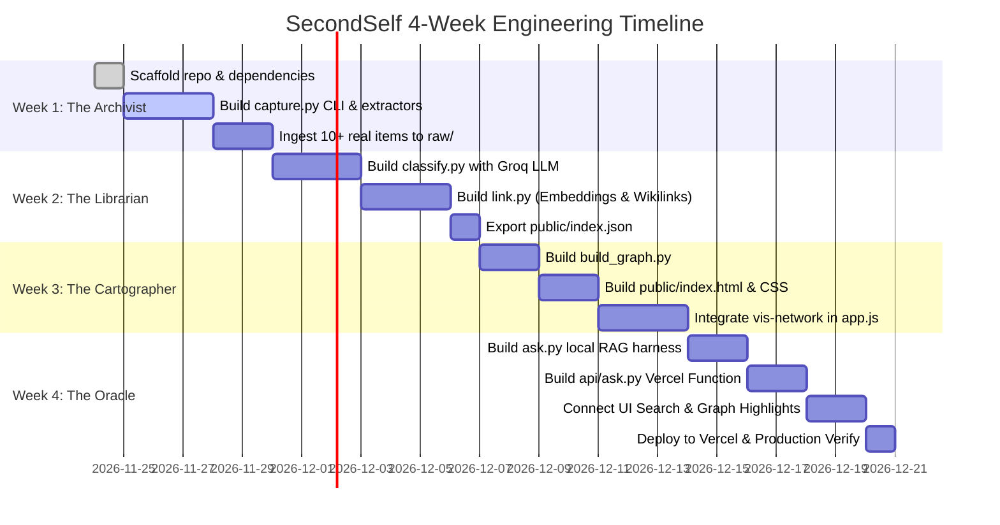

# SecondSelf — Comprehensive Implementation Plan

## 1. Plan Overview & Engineering Approach

This implementation plan translates [PROBLEM_STATEMENT.md](file:///d:/Second-Self/PROBLEM_STATEMENT.md) and [Architecture.md](file:///d:/Second-Self/Architecture.md) into an actionable, phased engineering blueprint. 

### Core Goals
1. Deliver a robust, autonomous personal knowledge base across four consecutive milestones:
   - **Week 1 (The Archivist):** Frictionless multi-modal capture pipeline (`capture.py`, `raw/`).
   - **Week 2 (The Librarian):** Automated PARA classification via Groq LLM + vector auto-linking (`classify.py`, `link.py`, `wiki/`).
   - **Week 3 (The Cartographer):** Graph projection + static force-directed canvas UI (`build_graph.py`, `public/`).
   - **Week 4 (The Oracle):** Serverless RAG synthesis engine (`api/ask.py`) deployed live on Vercel.
2. Adhere strictly to **Vercel Serverless Constraints**:
   - Zero PyTorch or large binary dependencies in serverless functions.
   - Decoupled offline build pipeline vs. lightweight online query serving.
   - Sub-second retrieval and LLM response execution.

---

## 2. Phase 0: Environment Setup, Tooling & Scaffolding

### 2.1 Directory Scaffolding
Create the foundational repository structure:

```bash
mkdir -p raw wiki/Projects wiki/Areas wiki/Resources wiki/Archives api public
```

### 2.2 Dependency Stratification Setup
To guarantee that the production bundle deployed to Vercel stays well below the 250 MB unzipped limit, dependencies are divided into two distinct files:

#### `requirements.txt` (Production Serverless Dependencies — Lightweight, < 50MB)
```text
groq>=0.11.0
numpy>=1.24.0,<2.0.0
pydantic>=2.0.0
requests>=2.31.0
```

#### `requirements-dev.txt` (Local Offline Build Dependencies — Heavy ML)
```text
-r requirements.txt
torch>=2.2.0
sentence-transformers>=3.0.0
trafilatura>=1.6.0
beautifulsoup4>=4.12.0
pypdf>=4.0.0
python-dotenv>=1.0.0
rich>=13.7.0
click>=8.1.0
```

### 2.3 Environment & Configuration Setup
1. **`.env.example`**
   ```bash
   GROQ_API_KEY=gsk_your_groq_api_key_here
   EMBEDDING_MODEL=sentence-transformers/all-MiniLM-L6-v2
   SIMILARITY_THRESHOLD=0.65
   TOP_K_LINKS=5
   ```
2. **`.gitignore`**
   ```text
   .env
   __pycache__/
   *.pyc
   .venv/
   env/
   .vercel/
   .pytest_cache/
   raw/*.tmp
   ```
3. **`vercel.json`**
   ```json
   {
     "version": 2,
     "cleanUrls": true,
     "rewrites": [
       { "source": "/api/ask", "destination": "/api/ask.py" }
     ],
     "functions": {
       "api/ask.py": {
         "maxDuration": 15,
         "memory": 1024
       }
     }
   }
   ```

---

## 3. Phase 1: Milestone 1 — The Archivist (Capture Pipeline)

### Objective
Create a unified CLI command that ingests arbitrary information (raw thoughts, web URLs, local files) and archives them immutably into `raw/` with unique IDs and timestamps.

### 3.1 Task 1.1: Capture CLI Interface (`capture.py`)
- Implement a command-line utility using Python's `argparse` or `click`.
- Support multiple input modes:
  - `--text "..."` / `-t "..."`: Direct note or quick thought.
  - `--url "https://..."` / `-u "..."`: Web page or online article.
  - `--file "/path/to/doc"` / `-f "/path/to/doc"`: Local PDF, text, or markdown file.
  - Stdin pipe: `cat file.txt | python capture.py --stdin`.
  - Interactive mode if no arguments are passed.

### 3.2 Task 1.2: Content Extraction Adapters
Implement robust extractors in `capture.py`:
1. **Text Adapter:** Captures raw string directly without alteration.
2. **Web URL Adapter:**
   - Fetch page HTML with user-agent headers.
   - Use `trafilatura` to extract clean article text, metadata (title, author, date), and strip boilerplate.
   - Fallback to `beautifulsoup4` if `trafilatura` fails.
3. **File Adapter:**
   - Detect MIME type or file extension (`.pdf`, `.txt`, `.md`).
   - For PDFs, extract text using `pypdf.PdfReader` page by page.
   - For text/markdown, read standard UTF-8 stream.

### 3.3 Task 1.3: Immutable Raw Storage Serialization
- Generate a unique ID: UUIDv4 (`uuid.uuid4()`).
- Format UTC timestamp in ISO-8601 (`YYYYMMDD_HHMMSS`).
- File naming pattern: `raw/{timestamp}_{short_id}.json`.
- Payload structure:
  ```json
  {
    "id": "c4b1e2a0-8f9d-4e1b-b2c3-9a8d7e6f5c4b",
    "timestamp": "2026-11-23T09:15:30.124Z",
    "source_type": "url",
    "source_uri": "https://example.com/deep-dive",
    "raw_content": "Extracted text content...",
    "metadata": {
      "title": "Deep Dive into Knowledge Engines",
      "char_count": 4820,
      "content_hash": "sha256_hash_here"
    }
  }
  ```

### 3.4 Task 1.4: Validation & Deliverable Verification
- Ingest **10+ real pieces of data**:
  - 3+ technical URLs/articles.
  - 3+ local documents/PDFs.
  - 4+ personal notes, thoughts, and ideas.
- Verify:
  ```bash
  python capture.py -t "Idea for SecondSelf: use force-directed physics to cluster PARA categories"
  python capture.py -u "https://en.wikipedia.org/wiki/Cosine_similarity"
  python capture.py -f "./sample_paper.pdf"
  ls -la raw/
  ```
- **Acceptance Criteria Check:**
  - [ ] `raw/` and `wiki/` directory hierarchy verified.
  - [ ] Single CLI command successfully captures text, URLs, and files.
  - [ ] Every captured item has timestamp, unique ID, and metadata.
  - [ ] 10+ real items populated in `raw/`.

---

## 4. Phase 2: Milestone 2 — The Librarian (Auto-Classify & Auto-Link)

### Objective
Transform unstructured raw captures into structured, classified markdown notes in `wiki/` using Groq Llama 3 under the PARA framework, and compute dense vector embeddings to auto-link related notes.

### 4.1 Task 2.1: Autonomous PARA Classification (`classify.py`)
1. **Groq Client Integration:**
   - Initialize `Groq(api_key=os.environ["GROQ_API_KEY"])`.
   - Default model: `llama-3.3-70b-versatile` (or `llama-3.1-8b-instant` for ultra-fast processing).
2. **PARA System Prompting & Schema:**
   - Supply explicit definitions of Projects, Areas, Resources, and Archives.
   - Instruct the LLM to output pure JSON with keys:
     - `category`: Must be one of `["Projects", "Areas", "Resources", "Archives"]`.
     - `title`: Concise descriptive note title (max 8 words).
     - `tags`: List of 3-6 lowercase hyphenated tags (e.g. `["vector-search", "rag", "ai"]`).
     - `summary`: High-signal 1-2 sentence core takeaway.
     - `cleaned_markdown`: Formatted markdown with key insights, bullet points, and code blocks preserved.
3. **Execution Loop & Idempotency:**
   - Scan `raw/*.json`. Check if an existing note with matching `id` already exists in `wiki/*/*.md`.
   - If not processed, invoke Groq API with exponential backoff retry.
   - Write output file to: `wiki/{category}/{id}.md` with YAML frontmatter.

### 4.2 Task 2.2: Semantic Vectorization & Auto-Linking (`link.py`)
1. **Embedding Model Initialization:**
   - Load `sentence_transformers.SentenceTransformer('all-MiniLM-L6-v2')`.
2. **Corpus Traversal & Embedding Matrix Generation:**
   - Read all `.md` files in `wiki/**/*.md`.
   - Parse YAML frontmatter (extract `id`, `title`, `summary`, `tags`, `category`).
   - Construct composite text representation:
     ```python
     text_payload = f"{title}\n{summary}\n{' '.join(tags)}\n{content[:1500]}"
     ```
   - Generate embeddings: $V = \text{model.encode}([\text{payload}_1, \dots, \text{payload}_N], \text{normalize_embeddings}=\text{True})$.
3. **Pairwise Similarity & Link Calculation:**
   - Compute cosine similarity matrix $S = V \cdot V^T$.
   - For each note $i$, find all notes $j \ne i$ where $S_{i,j} \ge \theta$ (default $\theta = 0.65$).
   - Rank matches by score descending and take top $k_{\max} = 5$.
4. **Markdown Link Injection:**
   - Read existing note markdown.
   - Check for or replace the `## Related Notes` section.
   - Inject reciprocal Wikilinks:
     ```markdown
     ## Related Notes
     - [[<note_id>|<title>]] — Match: 84%
     - [[<note_id_2>|<title_2>]] — Match: 72%
     ```
5. **Portable Semantic Index Export (`public/index.json`):**
   - Save precomputed vectors and metadata so that the serverless query function can execute without PyTorch:
     ```json
     {
       "model": "all-MiniLM-L6-v2",
       "dimensions": 384,
       "generated_at": "ISO-TIMESTAMP",
       "notes": [
         {
           "id": "c4b1e2a0-8f9d-4e1b-b2c3-9a8d7e6f5c4b",
           "title": "Modern RAG Architecture",
           "category": "Resources",
           "summary": "Decoupled pipeline for serverless environments.",
           "tags": ["rag", "architecture"],
           "content": "Full markdown note text...",
           "embedding": [0.041, -0.012, 0.082, "... 384 floats ..."]
         }
       ]
     }
     ```

### 4.3 Task 2.3: Verification on Real Data
- Run `python classify.py` on 15+ real captures. Verify proper distribution across `wiki/Projects/`, `wiki/Areas/`, `wiki/Resources/`, `wiki/Archives/`.
- Run `python link.py`. Inspect markdown notes to verify that related notes are automatically hyperlinked.
- **Acceptance Criteria Check:**
  - [ ] Raw captures automatically converted into PARA categorized notes.
  - [ ] Markdown notes have valid YAML frontmatter + summaries + tags.
  - [ ] Embeddings calculated locally and exported to `public/index.json`.
  - [ ] Related notes automatically linked with `[[wikilinks]]`.
  - [ ] Tested on 15+ real items.

---

## 5. Phase 3: Milestone 3 — The Cartographer (Visual Living Brain)

### Objective
Project the wiki notes and bidirectional links into an interactive force-directed graph rendered on a static web canvas that can be deployed to Vercel.

### 5.1 Task 3.1: Graph Projection Generator (`build_graph.py`)
1. Traverse all `.md` files in `wiki/**/*.md`.
2. Extract note ID, title, category, tags, and summary.
3. Parse `## Related Notes` section using regular expressions:
   ```python
   re.findall(r"\[\[(.*?)(\|(.*?))?\]\]", related_section)
   ```
4. Build Node and Edge structures:
   - **Nodes:**
     - `id`: Unique note ID.
     - `label`: Note title.
     - `group`: PARA category.
     - `value`: Degree centrality count (number of incoming + outgoing links) to control visual node size.
     - `summary`: Note summary for quick preview.
     - `tags`: Tag array.
   - **Edges:**
     - `from`: Source note ID.
     - `to`: Target note ID.
     - `value`: Similarity weight.
     - `title`: Tooltip percentage match.
5. Serialize to `public/graph.json`.

### 5.2 Task 3.2: Static Frontend Implementation (`public/`)
Build a high-performance single-page application without heavy framework dependencies:

1. **`public/index.html`**
   - Single layout with:
     - Top Navigation: Search bar ("Ask your Second Brain..."), Category filter toggles, Stats indicator (Total Notes, Total Links).
     - Fullscreen canvas container `<div id="network-canvas"></div>`.
     - Category legend pill bar (Projects: Amber, Areas: Blue, Resources: Green, Archives: Slate).
     - Slide-out Side Drawer: Displays full note markdown, tags, category badge, and clickable backlinks when a node is selected.
     - Bottom-up Ask/Synthesis Panel: Displays AI-generated answers, citations, and execution latency.
2. **`public/style.css`**
   - Dark modern theme (e.g. Slate/Zinc palette).
   - Glassmorphism drawer and search inputs (`backdrop-filter: blur(12px)`).
   - Responsive breakpoints for mobile/tablet/desktop.
   - Custom animations for pulsing nodes when referenced in an AI answer.
3. **`public/app.js`**
   - Load `graph.json` via `fetch('/graph.json')`.
   - Initialize `vis.Network(container, data, options)`.
   - Configure physics parameters:
     ```javascript
     const options = {
       nodes: {
         shape: 'dot',
         scaling: { min: 10, max: 35 },
         font: { color: '#E2E8F0', size: 14, face: 'Inter' }
       },
       groups: {
         Projects: { color: { background: '#F59E0B', border: '#D97706' } },
         Areas: { color: { background: '#3B82F6', border: '#2563EB' } },
         Resources: { color: { background: '#10B981', border: '#059669' } },
         Archives: { color: { background: '#6B7280', border: '#4B5563' } }
       },
       physics: {
         solver: 'barnesHut',
         barnesHut: {
           gravitationalConstant: -3000,
           centralGravity: 0.3,
           springLength: 95,
           springConstant: 0.04,
           damping: 0.09
         },
         stabilization: { iterations: 150 }
       },
       interaction: { hover: true, tooltipDelay: 100 }
     };
     ```
   - Event listeners:
     - `network.on('click', (params) => { ... })`: Open slide-out note reader.
     - `network.on('hoverNode', (params) => { ... })`: Show rich floating preview tooltip.
     - Search & Filter: Filter nodes by category buttons or keyword search bar.

### 5.3 Task 3.3: Local Preview & Verification
- Test locally using Python built-in server:
  ```bash
  python -m http.server 8000 --directory public
  ```
- **Acceptance Criteria Check:**
  - [ ] `build_graph.py` generates valid `public/graph.json` with nodes and edges.
  - [ ] Interactive force-directed graph renders smoothly in browser.
  - [ ] Hover displays note content summary.
  - [ ] Drag, zoom, and category filtering work without errors.
  - [ ] Real notes and links are accurately represented.

---

## 6. Phase 4: Milestone 4 — The Oracle (Ask Your Brain & Vercel Shipping)

### Objective
Wire up conversational RAG over the knowledge base, package the ask logic into a Vercel Serverless Function at `api/ask.py`, connect it to the visual canvas, and deploy live on Vercel.

### 6.1 Task 4.1: Standalone Retrieval & Synthesis Engine (`ask.py`)
1. **Zero-PyTorch Retrieval Architecture:**
   - In `ask.py`, implement vector search using pure NumPy or Python standard math.
   - For query vectorization:
     - **Option 1 (FastEmbed / ONNX):** Run a compact ONNX quantized model (`fastembed`) without torch (~30MB runtime).
     - **Option 2 (Hosted Embeddings API):** Use HuggingFace Inference API or Jina AI Embeddings with `sentence-transformers/all-MiniLM-L6-v2` to get query embedding $q \in \mathbb{R}^{384}$.
     - **Option 3 (Hybrid Semantic + Keyword Search):** Match query embedding against precomputed embeddings in `public/index.json` using vectorized cosine dot product.
2. **Context Construction & Prompt Engineering:**
   - Rank notes by cosine similarity; filter out scores $< 0.40$; take top $K=3 \dots 5$ notes.
   - Assemble context block containing note title, category, summary, content, and ID tags.
   - Invoke Groq API (`llama-3.3-70b-versatile`) with strict citation instructions:
     ```
     You are SecondSelf, answering exclusively based on the user's notes.
     Cite every statement using [Note: <id>]. If the notes do not have enough info, say so.
     ```
3. **Local CLI Testing:**
   ```bash
   python ask.py "What are the core architectural principles of my second brain?"
   ```

### 6.2 Task 4.2: Vercel Serverless Function (`api/ask.py`)
1. **Serverless Handler Implementation:**
   - Structure `api/ask.py` for Vercel's Python runtime (`from http.server import BaseHTTPRequestHandler`).
   - Extract `question` from POST body.
   - Read `public/index.json` (cached in module-level global variable across hot invocations).
   - Perform query vectorization and dot-product ranking.
   - Invoke Groq LLM API.
   - Return HTTP 200 with JSON payload:
     ```json
     {
       "answer": "Synthesized answer with [Note: c4b1...] citations.",
       "sources": [
         { "id": "c4b1...", "title": "Modern RAG Architecture", "category": "Resources", "score": 0.84 }
       ],
       "latency_ms": 720
     }
     ```
2. **Error & CORS Handling:**
   - Add proper HTTP status codes (`400 Bad Request`, `405 Method Not Allowed`, `500 Server Error`).
   - Allow cross-origin requests for local testing.

### 6.3 Task 4.3: UI Search Bar & Graph Citation Highlighting
1. Update `public/app.js` to bind search bar submission to `fetch('/api/ask', { method: 'POST', body: JSON.stringify({ question }) })`.
2. Display loading skeleton indicator while awaiting synthesis.
3. Render formatted markdown answer in the synthesis drawer.
4. **Visual Node Highlighting:**
   - When sources are returned, extract source `id`s.
   - Call `network.selectNodes(sourceIds)` and zoom/fit canvas to focus on cited notes:
     ```javascript
     network.fit({ nodes: sourceIds, animation: { duration: 1000, easingFunction: 'easeInOutQuad' } });
     ```
   - Temporarily highlight or pulse the source nodes on the canvas.

### 6.4 Task 4.4: Vercel Deployment & Production Shipping
1. Set up GitHub repository:
   ```bash
   git init
   git add .
   git commit -m "feat: complete SecondSelf personal AI second brain"
   git remote add origin https://github.com/<your-username>/secondself.git
   git push -u origin main
   ```
2. Deploy to Vercel:
   - Import the repository via Vercel Dashboard or run `vercel --prod` via CLI.
   - Configure **Environment Variables** in Vercel Project Settings:
     - `GROQ_API_KEY`: `gsk_...`
3. Verify live deployment at `https://secondself.vercel.app`:
   - [ ] Graph loads instantly from CDN edge.
   - [ ] Hover tooltips, click drawer, and drag/zoom work.
   - [ ] Search query returns real synthesized answers in $< 1.5$ seconds.
   - [ ] Cited notes highlight directly on the interactive graph.

---

## 7. Complete Task Breakdown & Dependencies Matrix



---

## 8. Testing & Quality Assurance Matrix

| Test Level | Target Subsystem | Test Case | Success Criteria |
|---|---|---|---|
| **Unit** | `capture.py` (Text) | Ingest raw text snippet via CLI | JSON file created in `raw/` with valid UUID and ISO timestamp. |
| **Unit** | `capture.py` (URL) | Ingest article URL | Clean article text extracted with HTML tags and ads removed. |
| **Unit** | `capture.py` (PDF) | Ingest local PDF document | Text extracted across all readable pages. |
| **Integration** | `classify.py` | Send raw capture to Groq | Valid JSON response with PARA category, tags, and summary. |
| **Integration** | `link.py` | Compute similarity matrix | Notes with similarity $\ge 0.65$ receive reciprocal `[[wikilinks]]`. |
| **Unit** | `build_graph.py` | Traverse wiki notes | Valid `public/graph.json` generated with nodes, edges, and degree centrality. |
| **UI / Visual** | `public/index.html` | Load page in Chrome/Safari | Canvas renders force-directed nodes, hover tooltips appear, zero console errors. |
| **Integration** | `api/ask.py` | Send POST request with question | Sub-second response with synthesized answer and valid source IDs. |
| **System** | Vercel Deployment | Cold start invocation | `/api/ask` executes in $< 1.5\text{s}$ without package size or timeout errors. |

---

## 9. Day-to-Day Operational Runbook

When you want to capture new knowledge and update your live SecondSelf brain:

```bash
# 1. Capture new information
python capture.py -u "https://news.ycombinator.com/item?id=..."
python capture.py -t "Idea: Train a domain-specific model for second brain classification"

# 2. Run the classification pipeline
python classify.py

# 3. Compute semantic embeddings & auto-link notes
python link.py

# 4. Rebuild the graph visualization data
python build_graph.py

# 5. Preview locally
python -m http.server 8000 --directory public

# 6. Push to GitHub (Triggers automated Vercel production redeploy)
git add raw/ wiki/ public/
git commit -m "feat: ingest and index new knowledge captures"
git push origin main
```

---

## 10. Risk Management & Failure Mitigations

1. **Risk: Serverless Python Function Exceeds 250 MB Bundle Size**
   - *Mitigation:* Ensure `torch` and `sentence-transformers` remain strictly in `requirements-dev.txt`. Verify with Vercel deployment preview before production releases.
2. **Risk: Groq API Rate Limiting During Bulk Ingestion**
   - *Mitigation:* Implement exponential backoff in `classify.py` and `link.py` with batch sleep intervals (e.g. 0.5s pause between requests).
3. **Risk: Graph "Hairball" Over-Clustering**
   - *Mitigation:* Enforce similarity threshold $\theta \ge 0.65$ and cap maximum edges per node to $k_{\max} = 5$ to preserve graph legibility.
4. **Risk: Hallucinated Citations in Synthesis**
   - *Mitigation:* Provide explicit IDs in the system prompt context. In `api/ask.py`, cross-check cited IDs against the retrieved `top_k` set before returning to the frontend.
