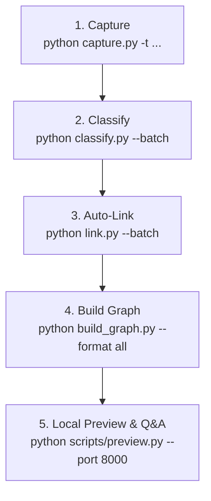

# SecondSelf — Autonomous Personal AI Second Brain

[](pyproject.toml)
[](Docs/Architecture.md)
[](tests/)
[](public/)
[](vercel.json)
[](LICENSE)

> **"Not a notes app. Not a chatbot. A brain that organizes itself and answers for you."**

---

## 🌟 Overview

Every traditional notes app suffers from the **Ingestion Friction vs. Retrieval Decay Paradox**: you capture hundreds of notes, bookmarks, PDFs, and ideas—and then they sit in hierarchical folders, unread, unconnected, and unsearchable by semantic intent. Information goes in, but nothing comes back out.

**SecondSelf** solves this by establishing an end-to-end, autonomous knowledge lifecycle:
1. **Capture anything** (quick thought, web URL, PDF, Markdown file, or piped CLI input).
2. **AI automatically classifies & files it** into Tiago Forte's **PARA** method (*Projects, Areas, Resources, Archives*) using hybrid heuristic and LLM logic.
3. **AI vectorizes & auto-links it** using dense semantic embeddings, computing category centroids and bidirectional `[[wikilinks]]`.
4. **Projects a deterministic knowledge graph** consumable by interactive canvas visualizers and graph databases.
5. **Answers natural-language questions** via a grounded, sub-second serverless RAG engine with strict citation discipline and bidirectional visual graph highlighting.
6. **Deploys globally to Vercel** with a zero-cost serverless architecture, requiring no persistent database or heavy runtime servers.

---

## 🏗️ System Architecture & Dual-Plane Design

SecondSelf solves the tension between heavy machine-learning dependencies (`PyTorch`, `sentence-transformers`) and serverless deployment limits (250 MB unzipped bundle, read-only filesystem, 15s timeouts) by strictly decoupling execution into two operational planes:

```
┌────────────────────────────────────────────────────────────────────────┐
│                      OFFLINE LOCAL BUILD PLANE                         │
│                                                                        │
│ ┌──────────────┐   capture.py    ┌──────────────┐    classify.py       │
│ │ User Input:  │────────────────>│  raw/*.json  │─────────────────┐    │
│ │ Note/URL/PDF │                 │ (Content-Hash│                 │    │
│ └──────────────┘                 │   Storage)   │                 ▼    │
│                                  └──────────────┘        ┌───────────┐ │
│                                                          │ wiki/**/*.│ │
│                                                          │    md     │ │
│                                                          └─────┬─────┘ │
│                                  Sentence-Transformers         │       │
│                                            ▼                   │       │
│ ┌──────────────┐   JSON Export   ┌──────────────────┐          │       │
│ │build_graph.py│<────────────────│     link.py      │<─────────┘       │
│ │ (graph.json) │                 │(public/index.json│                  │
│ └──────┬───────┘                 └──────────────────┘                  │
└────────┼───────────────────────────────────────────────────────────────┘
         │ Git Push / CI-CD
         ▼
┌────────────────────────────────────────────────────────────────────────┐
│                       VERCEL CLOUD RUNTIME PLANE                       │
│                                                                        │
│ ┌────────────────────────────────────────────────────────────────────┐ │
│ │                  Vercel Static Edge CDN (public/)                  │ │
│ │  • index.html (Responsive Canvas, Toolbar, Q&A Search Bar)         │ │
│ │  • app.js & vis-network (High-performance 60fps Force Physics)     │ │
│ │  • graph.json & index.json (Pre-computed Vector & Graph Models)    │ │
│ └──────────────────────────────────┬─────────────────────────────────┘ │
│                                    │ User Natural Language Query       │
│                                    ▼                                   │
│ ┌────────────────────────────────────────────────────────────────────┐ │
│ │               Vercel Serverless Function (api/ask.py)              │ │
│ │  • Sub-millisecond Cosine Dot-Product Ranking (Pure NumPy)         │ │
│ │  • Context Assembly & Semantic Graph Traversal Expansion           │ │
│ │  • Ultra-Low Latency Inference via Groq LPU (Llama 3 70B/8B)       │ │
│ │  • Strict Citation Enforcement & Grounded Synthesis                │ │
│ └────────────────────────────────────────────────────────────────────┘ │
└────────────────────────────────────────────────────────────────────────┘
```

### Why Decoupled Planes (No Streamlit / Persistent Server)?
- **Zero Idle Cost:** Vercel serverless functions scale to zero. No expensive $20–$50/month EC2, Render, or Railway containers running 24/7.
- **Ultra-Fast Edge Delivery:** The knowledge graph and frontend assets are distributed across Vercel's global CDN edge.
- **Fluid 60 FPS Physics:** Graph physics run on the client via `vis-network` canvas rendering without lagging WebSocket roundtrips.
- **Lightweight Serverless Bundle:** Pre-computing dense embeddings locally means production serverless functions only require pure `NumPy` (~25 MB), comfortably under Vercel's 250 MB ceiling.

---

## ⚡ Key Features

| Capability | Module | Description |
|---|---|---|
| **Multi-Modal Capture** | `capture.py` | Ingests text, URLs, PDFs, and markdown files into content-addressed, immutable storage (`raw/`) with SHA-256 deduplication. |
| **Autonomous PARA Sort** | `classify.py` | Evaluates urgency, responsibility, and reference signals via Groq Llama 3 to classify notes into Projects, Areas, Resources, or Archives. |
| **Semantic Auto-Linking** | `link.py` | Vectorizes content with `all-MiniLM-L6-v2`, computes category centroids, creates cosine-similarity links, and injects `[[wikilinks]]`. |
| **Graph Projection** | `build_graph.py` | Generates schema-versioned node-link graphs with stable IDs, exported to `public/graph.json` (and Cytoscape / Neo4j CSV). |
| **Interactive Explorer** | `public/` | Accessible UI (WCAG 2.1 AA) with real-time PARA statistics, category filters, confidence thresholding, and a slide-out Note Details Drawer. |
| **Grounded AI Synthesis** | `ask.py` / `api/ask.py` | Answers natural language questions using retrieved corpus context. Synthesizes answers with strict `[1][2]` citations; degrades gracefully to pure retrieval mode if no LLM is present. |
| **Graph Citation Highlighting** | `public/js/highlight.js` | Clicking an answer citation dynamically scales and illuminates the cited nodes with a cyan glow, zooms the camera, and dims unrelated nodes. |

---

## 📂 Project Structure

```
SecondSelf/
├── api/                        # Vercel Serverless Function handlers
│   └── ask.py                  # POST /api/ask HTTP endpoint (CORS, bounds-checked)
├── ask/                        # Core RAG retrieval and synthesis engine
│   ├── context.py              # Context assembly, token budgeting, graph expansion
│   ├── retriever.py            # Cosine similarity ranking over precomputed vectors
│   └── synthesizer.py          # Groq LLM synthesis, citation discipline, verification
├── capture.py                  # Multi-Modal Knowledge Ingestion CLI (The Archivist)
├── classify.py                 # Autonomous PARA Classification CLI (The Librarian)
├── classify/                   # Heuristic rules, signals, Groq classifier, serializer
├── config/                     # Pydantic v2 type-safe application settings
├── Docs/                       # Comprehensive specifications, architecture, and runbooks
│   ├── Architecture.md         # Deep-dive technical system specification
│   ├── Conventions.md          # Engineering standards, typing, and style guide
│   ├── Decisions.md            # Architecture Decision Records (ADRs)
│   ├── deployment-runbook.md   # Production deployment and instant rollback runbook
│   └── graph-schema.md         # Schema specification for nodes, edges, and metadata
├── graph/                      # Knowledge graph projection engine (Task 3.1)
├── link.py                     # Semantic vectorization & auto-linking CLI (Task 2.2)
├── link/                       # Embedding stores, centroid math, wikilink injection
├── preview/                    # Unified local dev server bridging static assets & API
├── public/                     # Production static web assets
│   ├── index.html              # HTML5 application shell & accessible layout
│   ├── css/main.css            # Responsive dark-theme styling (WCAG 2.1 AA)
│   ├── js/                     # Vanilla JS modular frontend architecture
│   │   ├── app.js              # Coordinator managing graph, filters, and search
│   │   ├── citations.js        # Inline citation rendering and source cards
│   │   ├── graph.js            # Vis-network canvas physics & node rendering
│   │   ├── highlight.js        # Multi-channel citation node highlighting
│   │   └── search.js           # Conversational search bar with AbortController
│   ├── data/                   # Staged graph artifacts
│   ├── graph.json              # Canonical node-link graph artifact
│   └── index.json              # Pre-computed dense embedding vector index
├── raw/                        # Immutable, content-addressed raw ingestion vault
├── scripts/                    # Automation, preview, and verification scripts
│   ├── preview.py              # Unified localhost runner (serves public + /api/ask)
│   ├── test_api.py             # Serverless API contract and edge-case verification
│   ├── verify_deployment_readiness.py  # Production readiness and bundle budget audit
│   └── verify_frontend.py      # Automated static frontend quality gate
├── tests/                      # Automated test suite (178 unit, integration, & evals)
├── wiki/                       # Curated PARA markdown notes vault
│   ├── Projects/               # Active, time-bound efforts with finish lines
│   ├── Areas/                  # Ongoing standards and responsibilities
│   ├── Resources/              # Reference topics and interests
│   └── Archives/               # Completed or inactive items
├── .env.example                # Template for environment variables
├── pyproject.toml              # Build system, CLI entrypoints, and dependencies
├── requirements.txt            # Production Vercel dependencies (NO torch, < 50MB)
├── requirements-dev.txt        # Local development and build dependencies
└── vercel.json                 # Vercel deployment routing, rewrites, and security headers
```

---

## 🚀 Quickstart Guide

### 1. Prerequisites
- **Python:** Version `3.10`, `3.11`, or `3.12` installed.
- **Groq API Key:** Free API key from [console.groq.com](https://console.groq.com) (used for classification and Q&A synthesis).

### 2. Installation

Clone the repository and set up a virtual environment:

```powershell
# Clone the repository
git clone https://github.com/your-username/SecondSelf.git
cd SecondSelf

# Create and activate virtual environment
python -m venv .venv
.venv\Scripts\Activate.ps1   # On Windows (PowerShell)
# source .venv/bin/activate  # On Linux/macOS

# Install development & offline build pipeline dependencies
pip install --upgrade pip
pip install -r requirements-dev.txt
pip install -e .
```

### 3. Environment Configuration

Copy the sample environment file and add your credentials:

```powershell
cp .env.example .env
```

Edit `.env` with your preferred editor and supply your Groq API key:
```ini
GROQ_API_KEY=gsk_your_actual_key_here
GROQ_MODEL=llama-3.3-70b-versatile
SECONDSELF_EMBEDDING_PROVIDER=sentence-transformers
```

---

## 📖 End-to-End Workflow

SecondSelf operates as a seamless pipeline. Run the steps sequentially as you capture knowledge, or use the all-in-one command.



### Step 1: Capture Knowledge (The Archivist)
Capture any idea, web article, or file into the immutable `raw/` vault:

```powershell
# Capture direct text or thought
python capture.py --text "Idea: Build dynamic canvas graph filtering for SecondSelf"

# Capture a web article (fetches HTML, strips boilerplate, extracts clean text)
python capture.py --url "https://en.wikipedia.org/wiki/Second_brain"

# Capture a local document (Markdown, Text, or PDF)
python capture.py --file path/to/research_paper.pdf

# Capture piped stdin
echo "Immediate action item: Review deployment checklist" | python capture.py --stdin
```

### Step 2: Classify into PARA (The Librarian)
Classify captured raw items into **Projects**, **Areas**, **Resources**, or **Archives** using hybrid rule heuristics and Groq Llama 3:

```powershell
# Process all unclassified raw notes into wiki/
python classify.py --batch

# Dry-run inspection without writing files
python classify.py --batch --dry-run
```

### Step 3: Vectorize & Auto-Link
Generate 384-dimensional dense semantic embeddings, compute category centroids, and automatically discover and inject `[[wikilinks]]` between related notes:

```powershell
# Vectorize vault and update public/index.json
python link.py --batch

# Auto-link with custom similarity threshold (default: 0.65)
python link.py --batch --threshold 0.70 --top-k 5
```

### Step 4: Generate Knowledge Graph
Project the classified notes and semantic relationships into a normalized, schema-versioned graph artifact:

```powershell
# Generate public/graph.json and export graph summary
python build_graph.py --format all --stats
```

### Step 5: Run Localhost Server
Launch the unified local development server. This serves the static frontend on port `8000` while simultaneously routing live `POST /api/ask` requests to the serverless function handler:

```powershell
python scripts/preview.py --port 8000
```
Open **[http://localhost:8000](http://localhost:8000)** in your browser!

---

### 💡 The All-in-One Refresh Command
When capturing a new note, run this single line to capture, classify, link, update the graph, and see it immediately in your browser upon refresh:

```powershell
python capture.py --text "Your note content" && python classify.py --batch && python link.py --batch && python build_graph.py --format all
```

---

## 💬 Conversational Q&A (Ask Your Second Brain)

SecondSelf includes a grounded Question Answering engine that retrieves relevant notes using dense cosine similarity and synthesizes answers using Groq Llama 3 with exact citations.

### Using the Web UI
1. Open **[http://localhost:8000](http://localhost:8000)**.
2. Focus the top search bar (press `Ctrl+K`).
3. Type a natural language question (e.g., *"What projects are currently active?"* or *"Explain our vector linking methodology"*).
4. Click **Ask AI** (or check *Retrieval only* to inspect retrieved context without LLM synthesis).
5. Inspect the synthesized answer with clickable `[1][2]` badges. Notice how the cited notes automatically light up and zoom into view on the graph!

### Using the CLI
Query your second brain directly from the command line:

```powershell
# Ask in natural language
python ask.py "What are the core technical constraints of our Vercel deployment?"

# Inspect retrieval results only (no LLM call)
python ask.py "Explain the PARA method" --no-llm

# Retrieve with expanded 1-hop graph neighbors
python ask.py "How does vector linking work?" --expand-graph --top-k 5
```

---

## 🧪 Testing & Quality Assurance

SecondSelf maintains rigorous test coverage with **178 passing tests** spanning unit, integration, and evaluation suites.

### Run Full Test Suite
```powershell
python -m pytest
```

### Run Static Frontend Quality Gate
Validates HTML semantic markup, data contract schemas, CSS compliance, and accessibility:
```powershell
python scripts/verify_frontend.py
```

### Run Serverless API Contract Tests
Tests the `POST /api/ask` endpoint for input bounds, JSON validity, CORS headers, and error handling:
```powershell
python scripts/test_api.py
```

### Run Deployment Readiness & Bundle Audit
Verifies that `torch` and heavy ML dependencies are completely absent from `requirements.txt` and checks bundle sizes:
```powershell
python scripts/verify_deployment_readiness.py
```

---

## 🚢 Production Deployment to Vercel

SecondSelf is fully configured for continuous zero-cost deployment on Vercel.

### 1. Vercel Configuration Files
- **`vercel.json`**: Configures route rewrites (`/api/ask -> api/ask.py`, `/(.*) -> public/$1`), function memory (1024 MB), max duration (15s), and security headers.
- **`.python-version`**: Pinned to Python `3.12`.
- **`requirements.txt`**: Ultra-lightweight dependencies (pure `numpy`, `groq`, `pydantic`, `requests`).

### 2. Deploy via Vercel CLI
```powershell
# Install Vercel CLI if needed
npm install -g vercel

# Authenticate
vercel login

# Set production environment variable
vercel env add GROQ_API_KEY production

# Deploy to production
vercel --prod
```

### 3. Deploy via GitHub Integration
1. Push your repository to GitHub.
2. Import the project into the [Vercel Dashboard](https://vercel.com/new).
3. Under **Project Settings > Environment Variables**, add:
   - `GROQ_API_KEY` = your Groq API key
   - `GROQ_MODEL` = `llama-3.3-70b-versatile`
4. Click **Deploy**. Vercel will build and serve your static explorer and serverless API globally.

For comprehensive operational runbooks, rollback commands, and disaster recovery procedures, refer to [Docs/deployment-runbook.md](Docs/deployment-runbook.md).

---

## 🛡️ Security & Privacy

- **Data Privacy:** Your notes, raw captures, and wiki items remain entirely in your private repository and machine.
- **Zero Hallucination Tolerance:** The synthesis engine rejects ungrounded claims and verifies citations against retrieved source documents.
- **Ephemeral Runtimes:** The deployed serverless API operates on a strictly read-only filesystem; no external state or user prompts are persisted remotely.
- **No Hardcoded Secrets:** All credentials are dynamically loaded from environment variables (`.env` locally, encrypted secrets on Vercel).

---

## 📜 License

This project is licensed under the MIT License — see the [LICENSE](LICENSE) file for details.
