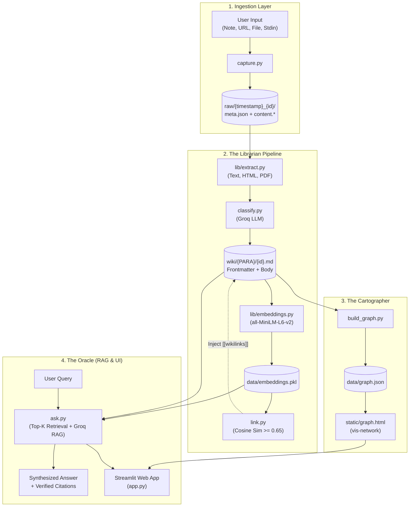

# 🧠 SecondSelf — Your Personal AI Second Brain

[](#)
[](#)
[](https://streamlit.io)
[](https://groq.com)
[](https://huggingface.co/sentence-transformers/all-MiniLM-L6-v2)
[](https://visjs.github.io/vis-network/)
[](#testing--verification)

> **"Not a notes app. Not a chatbot. A brain that organizes itself and answers for you."**

---

## 📌 Table of Contents

- [Overview & The Big Problem](#-overview--the-big-problem)
- [System Architecture](#-system-architecture)
- [The PARA Organizational Method](#-the-para-organizational-method)
- [Key Features](#-key-features)
- [Streamlit Web Interface](#-streamlit-web-interface)
- [Repository Structure](#-repository-structure)
- [Prerequisites](#-prerequisites)
- [Installation & Quickstart](#-installation--quickstart)
- [Configuration](#-configuration)
- [Usage Guide (CLI & Web UI)](#-usage-guide-cli--web-ui)
  - [1. Capture Material](#1-capture-material-capturepy)
  - [2. Process Knowledge Pipeline](#2-process-knowledge-pipeline-pipelinepy)
  - [3. Build & Preview the Graph](#3-build--preview-the-knowledge-graph-build_graphpy)
  - [4. Ask Questions via CLI](#4-ask-questions-via-cli-askpy)
  - [5. Launch the Streamlit Web Application](#5-launch-the-streamlit-web-application-apppy)
- [Caching & Performance Architecture](#-caching--performance-architecture)
- [Testing & Verification](#-testing--verification)
- [Privacy, Security & Data Boundaries](#-privacy-security--data-boundaries)
- [Known Limitations & Troubleshooting](#-known-limitations--troubleshooting)
- [Deployment (Streamlit Community Cloud)](#-deployment-streamlit-community-cloud)
- [License](#-license)

---

## 💡 Overview & The Big Problem

Every personal note app suffers from the same failure mode: **the notes graveyard**. You capture hundreds of thoughts, bookmarks, research links, and PDFs. Days later, they sit forgotten in deep folders. Information enters the system, but nothing useful ever emerges. Knowledge fails to compound.

**SecondSelf** solves this by establishing an autonomous, local-first knowledge brain:
1. **Frictionless Capture**: Capture notes, URLs, or local files via a single command or web sidebar.
2. **Autonomous Organization**: A fast cloud LLM (Groq) classifies every item into the proven **PARA framework** (Projects, Areas, Resources, Archives), generates semantic tags, and produces a single-line summary.
3. **Local Semantic Linking**: A local embedding model (`all-MiniLM-L6-v2`) computes dense vector representations and connects related notes using bidirectional wikilinks (`[[note-id]]`) based on cosine similarity without manual tagging.
4. **Interactive Force-Directed Graph**: Your knowledge space renders into a visual, dark-mode force-directed network graph powered by `vis-network`.
5. **Grounded Question Answering (RAG)**: Ask questions in plain English. SecondSelf retrieves the most relevant notes via semantic similarity and synthesizes a concise, fact-grounded response with transparent source citations. If your notes do not contain the answer, SecondSelf explicitly tells you rather than hallucinating.

---

## 🏗 System Architecture

SecondSelf is architected as a **local-first, pipeline-driven system**. There is no complex database daemon to manage: your filesystem (`raw/` and `wiki/`) is the human-inspectable source of truth.



For complete architectural specifications, schemas, and design rationales, refer to [architecture.md](architecture.md).

---

## 🗂 The PARA Organizational Method

SecondSelf structures all synthesized knowledge using Tiago Forte's **PARA framework**:

| Category | Definition | SecondSelf Storage Location | Graph Node Color |
|:---|:---|:---|:---|
| **Projects** | Active work with concrete outcomes and deadlines (e.g., active coding tasks, deliverables). | `wiki/Projects/{id}.md` | 🔵 Blue (`#3b82f6`) |
| **Areas** | Ongoing domains of activity and standards to maintain indefinitely (e.g., Health, Career, Finances). | `wiki/Areas/{id}.md` | 🟢 Green (`#10b981`) |
| **Resources** | Reference materials, learning topics, bookmarks, research papers, and cheat sheets. | `wiki/Resources/{id}.md` | 🟡 Amber (`#f59e0b`) |
| **Archives** | Completed, inactive, or superseded notes retained for historical reference. | `wiki/Archives/{id}.md` | ⚪ Slate (`#64748b`) |

---

## ✨ Key Features

- **Multi-Source Capture (`capture.py`)**:
  - Plain text or Markdown notes.
  - Web URLs with automatic HTML content extraction and fallback handling.
  - Local files (PDF documents with page extraction, plaintext, Python, JSON, YAML).
  - Terminal pipe / interactive stdin mode (`Ctrl+Z` on Windows, `Ctrl+D` on macOS/Linux).
  - SHA-256 content deduplication preventing accidental double-captures.
- **Multimodal Text Extraction (`lib/extract.py`)**:
  - Resilient UTF-8 and UTF-8 BOM text handling.
  - Web extraction powered by `requests` and `beautifulsoup4`.
  - PDF document parsing via `pypdf`.
- **Autonomous PARA Classification (`classify.py`)**:
  - Leverages Groq Cloud LLMs with structured JSON responses.
  - Generates YAML frontmatter including note ID, source capture ID, category, tags, and summary.
  - Incremental processing tracked via `data/index.json`.
- **Local Dense Semantic Embeddings (`lib/embeddings.py`)**:
  - Offline 384-dimensional dense vector embeddings generated with `sentence-transformers` (`all-MiniLM-L6-v2`).
  - Stored compactly in `data/embeddings.pkl` without external vector database dependencies.
- **Autonomous Relationship Linking (`link.py`)**:
  - Calculates pairwise cosine similarities across all notes.
  - Automatically injects bidirectional `[[target-id]]` wikilinks and YAML `links: [...]` for notes exceeding similarity threshold (default `0.65`).
- **Interactive Force-Directed Knowledge Graph (`build_graph.py` & `static/graph.html`)**:
  - Dynamic `vis-network` canvas with customizable physics (barnesHut).
  - Nodes color-coded by PARA category with real-time hover cards displaying title, category, tags, and a 200-character snippet.
  - Zoom, pan, drag, and click-to-highlight node connectivity.
- **Grounded Question Answering Engine (`ask.py`)**:
  - Semantic retrieval of Top-K relevant wiki notes (similarity threshold `>= 0.25`).
  - Strict RAG guardrails: 6,000 token context window, single-note character caps, and post-generation citation validation.
  - Refusal protection: Returns `"I don't have enough notes about that."` when context is insufficient, preventing hallucinations.
- **Integrated Streamlit Web Application (`app.py`)**:
  - Clean interface combining the Q&A search bar, answer display, interactive graph, and sidebar controls.
  - Quick note capture and one-click pipeline execution directly from the browser.
  - High-performance caching system with `@st.cache_resource` and `@st.cache_data`.

---

## 🖥 Streamlit Web Interface

The web application brings all components together in an intuitive layout:

```text
┌────────────────────────────────────────────────────────────────────────┐
│  🧠 SecondSelf — Personal Knowledge Brain         [ 🔄 Refresh Graph ] │
├────────────────────────────────────────────────────────────────────────┤
│  🔍 Ask Your Brain                                                     │
│  [ What are my current Q4 project goals?                   ] [ Ask ]   │
│                                                                        │
│  ┌─ Answer ──────────────────────────────────────────────────────────┐ │
│  │ You have two active Q4 projects: shipping the SecondSelf MVP and  │ │
│  │ completing the distributed systems certification. [7c40d9d2]      │ │
│  │                                                                   │ │
│  │ Sources:                                                          │ │
│  │ • [7c40d9d2] (Projects) Q4 Career Goals & Milestones              │ │
│  └───────────────────────────────────────────────────────────────────┘ │
├────────────────────────────────────────────────────────────────────────┤
│  🌐 Knowledge Graph                                                    │
│  ┌──────────────────────────────────────────────────────────────────┐  │
│  │               (Projects: Blue)      (Areas: Green)               │  │
│  │                     ● ────────────── ●                           │  │
│  │                    / \                \                          │  │
│  │                   ●   ● ────────────── ● (Resources: Amber)      │  │
│  │             [vis-network Interactive Canvas: Zoom / Pan / Drag]  │  │
│  └──────────────────────────────────────────────────────────────────┘  │
├────────────────────────────┬───────────────────────────────────────────┤
│  SIDEBAR: Capture & Tools  │  📊 Brain Stats                           │
│  [ Enter note content... ] │  • Notes: 15                              │
│  [ 💾 Capture Note ]       │  • Relationships: 22                      │
│  [ ⚙️ Process Pipeline ]   │  • Model: all-MiniLM-L6-v2                │
└────────────────────────────┴───────────────────────────────────────────┘
```

---

## 📁 Repository Structure

```text
secondself/
├── .streamlit/                   # Streamlit UI configuration
│   └── config.toml
├── data/                         # Derived state and indices (not hand-edited)
│   ├── .gitkeep
│   ├── embeddings.pkl            # Serialized note embedding vectors (384-dim)
│   ├── graph.json                # Graph nodes, edges, and metadata
│   └── index.json                # Checksums, raw_processed map, embeddings version
├── lib/                          # Shared library modules
│   ├── __init__.py
│   ├── embeddings.py             # sentence-transformers embedding & cosine sim
│   ├── extract.py                # Resilient text extraction (markdown, HTML, PDF)
│   ├── llm.py                    # Groq API client with backoff & prompt templates
│   ├── models.py                 # Dataclasses: CaptureMeta, WikiNote, GraphNode, AskResult
│   └── storage.py                # Filesystem persistence helpers (raw & wiki)
├── raw/                          # Immutable raw capture storage (append-only)
│   └── {YYYY-MM-DD}_{id}/        # Directory per capture
│       ├── content.*             # Raw text, HTML fallback, or binary
│       └── meta.json             # ID, timestamp, source, content_hash
├── static/                       # Web visualization assets
│   └── graph.html                # Standalone vis-network canvas with HUD
├── tests/                        # Automated test suite (265 tests across 14 modules)
│   ├── test_app.py               # Streamlit UI integration & component tests
│   ├── test_ask.py               # RAG retrieval & answer synthesis tests
│   ├── test_build_graph.py       # Graph JSON serialization & edge linking tests
│   ├── test_caching.py           # Streamlit caching & invalidation tests
│   ├── test_capture.py           # Note, link, and file capture tests
│   ├── test_classify.py          # PARA classification & frontmatter tests
│   ├── test_cli.py               # Command-line interface invocation tests
│   ├── test_edge_cases.py        # Corrupt data & filesystem resilience tests
│   ├── test_embeddings.py        # Vector embedding & similarity metric tests
│   ├── test_extract.py           # PDF, HTML, and text extraction tests
│   ├── test_link.py              # Semantic linking & wikilink injection tests
│   ├── test_llm.py               # Groq client & exponential backoff tests
│   ├── test_pipeline.py          # Central pipeline orchestration tests
│   └── test_validate_graph.py    # Graph schema validation tests
├── wiki/                         # Processed PARA knowledge hierarchy
│   ├── Projects/                 # Active projects with deadlines
│   ├── Areas/                    # Ongoing domains & responsibilities
│   ├── Resources/                # Reference docs, cheatsheets, bookmarks
│   └── Archives/                 # Inactive & historical material
├── .env.example                  # Environment variable template
├── .gitignore                    # Git ignore file (excludes secrets, venv, caches)
├── app.py                        # Streamlit web application entrypoint
├── architecture.md               # Detailed system design specification
├── ask.py                        # RAG question answering CLI and engine
├── build_graph.py                # Graph builder script generating data/graph.json
├── capture.py                    # Capture script for notes, links, and files
├── classify.py                   # PARA classification script using Groq LLM
├── link.py                       # Semantic linking script computing note similarities
├── pipeline.py                   # Central pipeline orchestrator (classify + link)
├── requirements.txt              # Production Python package dependencies
└── validate_graph.py             # Graph JSON sanity checker
```

---

## ⚙️ Prerequisites

- **Python**: Version `3.10` or higher (verified on Python 3.10, 3.11, 3.12, 3.13, and 3.14).
- **Groq API Key**: A free API key from [Groq Console](https://console.groq.com/keys) (`gsk_...`).
- **Operating System**: macOS, Linux, or Windows (tested on Windows 11 with PowerShell).
- **Git**: For source version control.
- **Web Browser**: Any modern browser (Chrome, Firefox, Safari, Edge) with JavaScript enabled.

---

## 🚀 Installation & Quickstart

### Step 1: Clone or Navigate to the Repository

```bash
git clone https://github.com/{your-username}/secondself.git
cd secondself
```

*(If working from the local folder, open your terminal in the `secondself/` directory).*

### Step 2: Create a Virtual Environment

```bash
# On macOS/Linux/Windows:
python -m venv .venv
```

### Step 3: Activate the Virtual Environment

- **Windows (PowerShell)**:
  ```powershell
  .venv\Scripts\Activate.ps1
  ```
- **Windows (Command Prompt)**:
  ```cmd
  .venv\Scripts\activate.bat
  ```
- **macOS / Linux**:
  ```bash
  source .venv/bin/activate
  ```

### Step 4: Install Dependencies

```bash
pip install --upgrade pip
pip install -r requirements.txt
```

---

## 🔑 Configuration

1. Copy the example environment template:
   - **Windows (PowerShell)**:
     ```powershell
     Copy-Item .env.example .env
     ```
   - **macOS / Linux**:
     ```bash
     cp .env.example .env
     ```

2. Open `.env` in any text editor and supply your Groq API key:
   ```env
   GROQ_API_KEY=gsk_yourActualGroqApiKeyHere
   ```

> [!IMPORTANT]
> Never commit your `.env` file to version control. The `.gitignore` file is configured to exclude `.env` automatically.

---

## 📖 Usage Guide (CLI & Web UI)

SecondSelf offers both an expressive command-line interface for scripting/automation and a unified web interface.

### 1. Capture Material (`capture.py`)

Capture any note, URL, or local document into `raw/`:

```bash
# Capture a quick text or Markdown note:
python capture.py note "Meeting notes with Sarah: Deliver Q4 architecture by Friday"

# Capture a research link:
python capture.py link "https://en.wikipedia.org/wiki/Retrieval-augmented_generation"

# Capture a local document or PDF:
python capture.py file path/to/document.pdf

# Interactive stdin capture (multiline):
python capture.py
# (Type or paste content; press Ctrl+Z then Enter on Windows, or Ctrl+D on macOS/Linux)
```

### 2. Process Knowledge Pipeline (`pipeline.py`)

Run the full autonomous pipeline to extract text, classify into PARA, compute embeddings, link related notes, and rebuild the knowledge graph:

```bash
# Full end-to-end processing (classify + link + build graph):
python pipeline.py process

# Run classification only:
python pipeline.py classify

# Run semantic linking only:
python pipeline.py link

# Dry-run preview without modifying files:
python pipeline.py process --dry-run

# Custom similarity threshold for linking (default: 0.65):
python pipeline.py link --threshold 0.70
```

### 3. Build & Preview the Knowledge Graph (`build_graph.py`)

Generate or update `data/graph.json` from the current notes in `wiki/`:

```bash
python build_graph.py
```

To preview the standalone visualization canvas locally:
```bash
python -m http.server 8000
# Open http://localhost:8000/static/graph.html in your browser
```

### 4. Ask Questions via CLI (`ask.py`)

Query your personal knowledge base in natural language directly from the terminal:

```bash
# Ask a general question:
python ask.py "What active projects am I currently working on?"

# Retrieve more context (top-k=5):
python ask.py "What machine learning resources do I have?" --top-k 5

# Override the Groq model:
python ask.py "Summarize my career objectives" --model openai/gpt-oss-20b

# Output structured JSON result (ideal for integrations):
python ask.py "What books did I read?" --json
```

Example CLI Output:
```text
Question: What active projects am I currently working on?

Answer:
Based on your notes, you have two active projects:
1. SecondSelf Knowledge Engine: Implementing Phase 4 RAG question-answering [a1b2c3d4].
2. Distributed Systems Certification: Preparing for the final assessment in December [e5f6a7b8].

Sources:
  - [a1b2c3d4] (Projects) SecondSelf Architecture & Implementation (score: 0.8412)
  - [e5f6a7b8] (Projects) Distributed Systems Study Notes (score: 0.7105)
```

### 5. Launch the Streamlit Web Application (`app.py`)

Start the interactive visual brain and search interface:

```bash
streamlit run app.py
```

Streamlit will automatically launch your default browser to `http://localhost:8501`.

---

## ⚡ Caching & Performance Architecture

SecondSelf incorporates multi-tier caching to guarantee low latency and immediate UI responsiveness across Streamlit reruns:

1. **Embedding Model Caching (`@st.cache_resource`)**:
   - `load_embeddings()` caches the initialized `SentenceTransformer("all-MiniLM-L6-v2")` in process memory.
   - Eliminates redundant multi-gigabyte PyTorch weight reloading on every query, reducing embedding latency from **~20.6 seconds** (cold load) to **~0.15 milliseconds** (warm rerun) — a **>140,000x speedup**.
2. **Graph Data Caching (`@st.cache_data`)**:
   - `load_graph()` caches parsed graph nodes and edges from `data/graph.json`.
   - Prevents disk I/O and JSON deserialization on interaction reruns, speeding up graph access by **~15.7x**.
3. **Targeted Cache Invalidation**:
   - Clicking **"Refresh Graph"** executes `load_graph.clear()`, reloading the graph without clearing the heavy ML model.
   - Clicking **"Process Pipeline"** in the sidebar executes `load_graph.clear()`, `load_embeddings.clear()`, and `load_note_embeddings.clear()`, ensuring newly classified notes immediately reflect across embeddings, links, and the visual canvas.

---

## 🧪 Testing & Verification

SecondSelf includes an automated test suite comprising **265 unit and integration tests across 14 test modules**, verifying 100% of pipeline components, edge cases, and UI interactions.

### Run All Unit Tests

From the `secondself/` directory:

```bash
python -m unittest discover tests
```

### Run Specific Test Modules

```bash
# Test Streamlit caching and invalidation:
python -m unittest tests/test_caching.py

# Test RAG retrieval and synthesis:
python -m unittest tests/test_ask.py

# Test Streamlit UI components and layout:
python -m unittest tests/test_app.py

# Test graph serialization:
python -m unittest tests/test_build_graph.py

# Test capture and deduplication:
python -m unittest tests/test_capture.py

# Test PARA classification:
python -m unittest tests/test_classify.py

# Test semantic linking:
python -m unittest tests/test_link.py

# Test pipeline orchestration:
python -m unittest tests/test_pipeline.py
```

---

## 🔒 Privacy, Security & Data Boundaries

SecondSelf is built around a **local-first** privacy model:

1. **Local Storage**: All captured material (`raw/`), organized notes (`wiki/`), vector embeddings (`data/embeddings.pkl`), and graph data (`data/graph.json`) reside entirely on your local machine.
2. **Cloud Transmission Boundaries**:
   - Only raw text snippets required for **classification** (during `pipeline.py classify`) and retrieved top-K context notes (during `ask.py`) are sent over encrypted TLS to the Groq Cloud API.
   - Your local notes are not used by Groq for public model training.
3. **Credential Sanitization**:
   - The application enforces automatic regex masking on user-facing error dialogs, ensuring API keys (`gsk_...`) and local filesystem paths are never leaked in the UI or logs.
4. **Data Safety Best Practice**:
   - Do **not** capture sensitive plaintext credentials, private cryptographic keys, passwords, or confidential banking information into SecondSelf.

---

## 🛠 Known Limitations & Troubleshooting

- **Groq Model Availability (`404 model_not_found`)**:
  - The default model configured in `lib/llm.py` is `llama-3.1-8b-instant`. On certain Groq accounts or free-tier quotas, this model may occasionally be rotated or unavailable.
  - **Resolution**: Pass any active model available on your Groq dashboard using the `--model` flag:
    ```bash
    python ask.py "My question" --model openai/gpt-oss-20b
    # or
    python ask.py "My question" --model qwen/qwen3.8-27b
    ```
- **Initial Empty State**:
  - On a fresh clone, `wiki/` contains no notes until you run the pipeline. If you ask a question before processing, SecondSelf will accurately reply: `"I don't have notes about that."`
  - **Resolution**: Capture notes or run `python pipeline.py process` to process existing items in `raw/`.
- **Hugging Face Hub Offline Mode**:
  - If running in an air-gapped or offline environment, ensure `all-MiniLM-L6-v2` has been downloaded at least once, then set:
    ```bash
    export HF_HUB_OFFLINE=1  # macOS/Linux
    $env:HF_HUB_OFFLINE="1"  # Windows PowerShell
    ```
- **Streamlit Local Port Conflict**:
  - If port `8501` is already in use, specify an alternative port:
    ```bash
    streamlit run app.py --server.port 8502
    ```

---

## 🌐 Deployment (Streamlit Community Cloud)

To share your SecondSelf brain publicly (Phase 4.2.7):

1. **Push to GitHub**:
   Ensure your repository is pushed to a public or private GitHub repository.
2. **Open Streamlit Community Cloud**:
   Navigate to [share.streamlit.io](https://share.streamlit.io) and click **"New app"**.
3. **Repository Settings**:
   - **Repository**: `your-username/secondself`
   - **Branch**: `main`
   - **Main file path**: `app.py`
4. **App Secrets Configuration**:
   In the Streamlit Cloud dashboard under **Advanced Settings > Secrets**, configure:
   ```toml
   GROQ_API_KEY = "gsk_yourActualGroqApiKeyHere"
   ```
5. **Pre-commit Sample Notes (Optional Demo Mode)**:
   For public showcase purposes, pre-commit populated `wiki/` notes, `data/graph.json`, and `data/embeddings.pkl` so external visitors can immediately explore the graph and ask questions.
6. **Live URL**:
   Your application will be live at:
   `https://secondself-{username}.streamlit.app`

---

## 📄 License

This project is licensed under the MIT License. See [LICENSE](LICENSE) for details.

